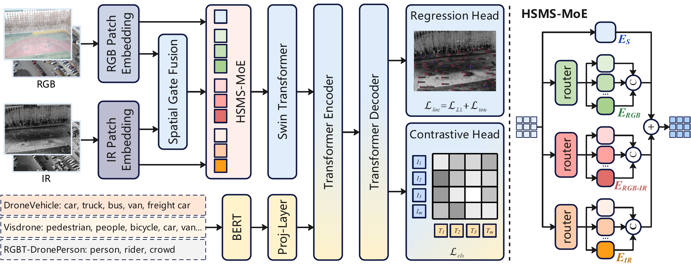

<div align="center">

# UniM2Det

**Unified Multi-dataset and Multi-modal UAV Object Detection**

</div>

UniM2Det is a unified framework for UAV object detection across heterogeneous label spaces and complementary RGB / infrared modalities. Built on a vision-language model, UniM2Det aligns visual and textual features to resolve label-space heterogeneity during joint training, and introduces **Spatial Gated Fusion (SGF)** and **Hybrid Shared and Modality-Specific Mixture-of-Experts (HSMS-MoE)** to adapt to modality quality variations and reduce modality conflicts.

This repository contains the official implementation of two works:

- **UniM2Det** (PRCV): hard Top-k routing with HSMS-MoE.
- **UniM2Det-S**: soft, slot-based expert collaboration with HSMS-Soft MoE.

Both models support RGB, IR and RGB-IR inputs, and are trained jointly on DroneVehicle, VisDrone and RGBT-DronePerson.

## Framework



## Highlights

- **Unified label space.** A VLM-based detection head uses text prompts to align heterogeneous labels across datasets and modalities.
- **Spatial Gated Fusion (SGF).** Spatially adaptive visible-infrared fusion under dynamic quality variations.
- **HSMS-MoE.** Shared experts are decoupled from modality-specific experts; each modality has dedicated dynamic routing to mitigate modality conflicts and expert imbalance.
- **HSMS-Soft MoE (UniM2Det-S).** Replaces discrete Top-k expert selection with slot-based soft dispatch/combination, enabling continuous multi-expert contribution, more spatially continuous routing, and no auxiliary load-balancing loss.

## Models

| Model | Routing | Experts | Config |
| --- | --- | --- | --- |
| UniM2Det (PRCV) | HSMS-MoE, hard Top-k | 4 experts, activate 2 | `configs/mm_grounding_dino/my_cfg/unim2det_swin-t_pretrain_multi_same_pe_pixmoe_p.py` |
| UniM2Det-S | HSMS-Soft MoE, soft slot-based | 2 experts, 8 slots | `configs/mm_grounding_dino/my_cfg/unim2det_swin-t_pretrain_multi_same_pe_softmoe.py` |

Ablation configs are also provided: `unim2det_swin-t_pretrain_multi_same_pe.py` and `unim2det_swin-t_pretrain_multi_same_pe_avg.py`.

## Papers

### UniM2Det: A Unified Model for Multi-dataset and Multi-modal UAV Object Detection (PRCV)

UAV object detection is crucial but challenged by complex environments and multi-modal perception needs. Existing methods typically target a single modality or dataset, fundamentally limiting cross-scene generalization and cross-modal adaptability. To overcome these limitations, we propose **UniM2Det**, a **uni**fied **m**ulti-dataset and **m**ulti-modal UAV object **det**ection framework. Compared with traditional multi-head architectures, UniM2Det is built upon a vision-language model (VLM) to elegantly resolve label space heterogeneity during joint training through visual and textual feature alignment. Furthermore, to effectively process multi-modal inputs, we introduce two critical components to enhance the flexibility and robustness of the unified framework. First, a Spatial Gated Fusion (SGF) module facilitates spatially adaptive interactions between visible and infrared features under dynamic quality variations. Second, we design a Hybrid Shared and Modality-Specific Mixture-of-Experts (HSMS-MoE) network to mitigate modality conflicts within the unified backbone and address the expert imbalance common in conventional shared-router MoE methods. HSMS-MoE explicitly decouples shared experts from modality-specific ones, equipping each modality with dedicated dynamic routing for diverse feature learning. Extensive experiments demonstrate that UniM2Det achieves state-of-the-art performance across multiple mainstream UAV datasets spanning RGB, IR, and RGB-IR modalities, validating its efficiency and robustness in complex, all-weather environments.

### UniM2Det-S: Soft Expert Collaboration for Unified Multi-dataset and Multi-modal UAV Object Detection

Unmanned aerial vehicle (UAV) object detection increasingly requires a unified detector to handle heterogeneous datasets, inconsistent label spaces, and complementary visible and infrared modalities. Vision-language models provide a unified semantic detection head, while spatial gated fusion enables adaptive integration of RGB and IR features. However, existing mixture-of-experts (MoE) routing for modeling modality diversity typically relies on discrete Top-k expert selection, which assigns each token to only a limited subset of experts. Such discrete selection restricts the joint contribution of multiple experts and can lead to frequent expert transitions between neighboring tokens, resulting in spatially discontinuous expert contributions. It also commonly relies on an auxiliary load-balancing loss to regulate expert utilization. To address these limitations, this paper presents UniM2Det-S, which introduces soft expert collaboration into the hybrid shared and modality-specific MoE architecture. Specifically, the proposed HSMS-Soft MoE replaces discrete Top-k expert selection with a soft, slot-based mechanism, where token-to-slot dispatch and slot-to-token combination enable multiple experts to contribute to each token with continuous weights. This design removes the need for the auxiliary load-balancing loss used in hard routing and enables more spatially continuous expert contributions. Extensive experiments on DroneVehicle, VisDrone, and RGBT-DronePerson demonstrate that UniM2Det-S achieves state-of-the-art performance for unified multi-dataset and multi-modal UAV object detection across RGB, IR, and RGB-IR inputs, while maintaining comparable model complexity and inference efficiency to hard routing. Further routing analysis quantitatively confirms the improved spatial continuity of soft expert collaboration.

## Repository Structure

```text
UniM2Det/
├── configs/mm_grounding_dino/my_cfg/
│   ├── data/data_multi_3data.py                # joint DroneVehicle + VisDrone + RGBT-DronePerson
│   ├── unim2det_..._pixmoe_p.py                # UniM2Det (PRCV)
│   ├── unim2det_..._softmoe.py                 # UniM2Det-S
│   └── unim2det_..._same_pe.py, _avg.py        # ablation configs
├── mmdet/
│   ├── models/backbones/                       # multi-modal Swin, PixMoE / SoftMoE / MoE
│   ├── models/detectors/                       # GroundingDINO_multi_MoE
│   └── datasets/                               # fusion datasets, transforms, evaluators
├── tools/train.py
├── tools/test.py
└── weights/                                    # pretrained weights and checkpoints (not tracked)
```

## Installation

### 1. Create the conda environment

```bash
conda create --name UniM2Det python=3.8 -y
conda activate UniM2Det
```

### 2. Install PyTorch

```bash
pip install torch==2.0.1 torchvision==0.15.2 torchaudio==2.0.2 --index-url https://download.pytorch.org/whl/cu118
```

### 3. Install MMEngine and MMCV

```bash
pip install -U openmim
mim install mmengine
mim install "mmcv==2.0.0"
```

### 4. Clone and install this repository

```bash
git clone https://github.com/vision4drones/UniM2Det.git
cd UniM2Det
pip install -v -e .
```

If you already have the repository, skip the `git clone` step and run `pip install -v -e .` from the repository root.

### 5. Install the remaining dependencies

```bash
pip install -r requirements/multimodal.txt
pip install emoji ddd-dataset -i https://pypi.tuna.tsinghua.edu.cn/simple
```

Install the LVIS API (choose one):

```bash
pip install git+https://github.com/lvis-dataset/lvis-api.git
```

or install it from a local clone:

```bash
git clone https://gitee.com/mirrors/lvis-api.git
cd lvis-api
pip install -e .
```

### 6. Pin NumPy

```bash
pip uninstall -y numpy
pip install numpy==1.23.5
```

### Known-good environment

| Component | Version |
| --- | --- |
| Python | 3.8 |
| PyTorch | 2.0.1 (CUDA 11.8) |
| torchvision | 0.15.2 |
| torchaudio | 2.0.2 |
| MMCV | 2.0.0 |
| MMEngine | installed by `mim install mmengine` |
| NumPy | 1.23.5 |
| MMDetection | 3.3.0 (this repository) |

## Dataset Preparation

The joint-training config `configs/mm_grounding_dino/my_cfg/data/data_multi_3data.py` expects the following standardized layout. The config uses repository-relative roots (`data/DroneVehicle/`, `data/VisDrone/`, `data/RGBTDronePerson/`); change those three `data_root` entries if your data lives elsewhere.

```text
data/
├── DroneVehicle/
│   ├── annotations/
│   │   ├── label_map.json
│   │   ├── train_visible.json
│   │   ├── train_thermal.json
│   │   ├── val_visible.json
│   │   └── val_thermal.json
│   └── images/
│       ├── train/
│       │   ├── visible/
│       │   └── thermal/
│       └── val/
│           ├── visible/
│           └── thermal/
├── VisDrone/
│   ├── annotations/
│   │   ├── label_map.json
│   │   ├── train.json
│   │   └── test.json
│   └── images/
│       ├── train/
│       └── test/
└── RGBTDronePerson/
    ├── annotations/
    │   ├── label_map.json
    │   ├── train.json
    │   └── val.json
    └── images/
        ├── train/
        │   ├── visible/
        │   └── thermal/
        └── val/
            ├── visible/
            └── thermal/
```

All datasets follow the same convention: annotations live in `annotations/`, images in `images/<split>/<modality>/`, and the class-label file is always `annotations/label_map.json`. Fusion datasets reuse the thermal-annotated files and pair `visible/` with `thermal/` by filename.

Training annotations use the ODVG format (`ODVGDataset` / `ODVGFusionDataset`): each `.json` file is line-delimited JSON with one sample per line. Validation/test annotations use the COCO format (`CocoDataset` / `CocoFusionDataset`). The multi-dataset evaluator reports metrics per dataset as well as overall results.

## Pretrained Weights

The configs resolve `weights_dir` relative to the config file, so the default location is `<repo>/weights/`. Place the files as follows:

```text
weights/
├── swin_tiny_patch4_window7_224.pth
├── bert-base-uncased/
└── grounding_dino_swin-t_pretrain_obj365_goldg_grit9m_v3det_20231204_095047-b448804b.pth
```

Sources:

- Swin-Tiny: <https://github.com/SwinTransformer/storage/releases/download/v1.0.8/swin_tiny_patch4_window7_224.pth>
- BERT: <https://huggingface.co/bert-base-uncased>
- Grounding DINO Swin-T pretrained checkpoint: <https://download.openmmlab.com/mmdetection/v3.0/mm_grounding_dino/grounding_dino_swin-t_pretrain_obj365_goldg_grit9m_v3det/grounding_dino_swin-t_pretrain_obj365_goldg_grit9m_v3det_20231204_095047-b448804b.pth>

If you keep the weights elsewhere, change only the single `weights_dir` line at the top of each config.

## Training

Single GPU:

```bash
# UniM2Det (PRCV)
python tools/train.py configs/mm_grounding_dino/my_cfg/unim2det_swin-t_pretrain_multi_same_pe_pixmoe_p.py \
    --amp --auto-scale-lr --work-dir work_dirs/unim2det_prcv

# UniM2Det-S
python tools/train.py configs/mm_grounding_dino/my_cfg/unim2det_swin-t_pretrain_multi_same_pe_softmoe.py \
    --amp --auto-scale-lr --work-dir work_dirs/unim2det_s
```

Multiple GPUs:

```bash
# UniM2Det (PRCV)
bash tools/dist_train.sh \
    configs/mm_grounding_dino/my_cfg/unim2det_swin-t_pretrain_multi_same_pe_pixmoe_p.py \
    8 --amp --auto-scale-lr --work-dir work_dirs/unim2det_prcv

# UniM2Det-S
bash tools/dist_train.sh \
    configs/mm_grounding_dino/my_cfg/unim2det_swin-t_pretrain_multi_same_pe_softmoe.py \
    8 --amp --auto-scale-lr --work-dir work_dirs/unim2det_s
```

The data config uses `batch_size=4` per GPU. Adjust it according to your GPU memory. `--auto-scale-lr` scales the learning rate automatically when the global batch size changes.

Resume training:

```bash
python tools/train.py configs/mm_grounding_dino/my_cfg/unim2det_swin-t_pretrain_multi_same_pe_softmoe.py \
    --resume auto --amp --auto-scale-lr --work-dir work_dirs/unim2det_s
```

## Evaluation

Single GPU:

```bash
python tools/test.py \
    configs/mm_grounding_dino/my_cfg/unim2det_swin-t_pretrain_multi_same_pe_pixmoe_p.py \
    weights/checkpoints/unim2det_prcv.pth
```

Multiple GPUs:

```bash
bash tools/dist_test.sh \
    configs/mm_grounding_dino/my_cfg/unim2det_swin-t_pretrain_multi_same_pe_softmoe.py \
    weights/checkpoints/unim2det_s.pth 8
```

## Citation

```bibtex
@inproceedings{unim2det,
  title     = {UniM2Det: A Unified Model for Multi-dataset and Multi-modal UAV Object Detection},
  author    = {TBD},
  booktitle = {PRCV},
  year      = {TBD}
}

@article{unim2det_s,
  title   = {UniM2Det-S: Soft Expert Collaboration for Unified Multi-dataset and Multi-modal UAV Object Detection},
  author  = {TBD},
  journal = {TBD},
  year    = {TBD}
}
```

## Acknowledgements

This project is built on [MMDetection](https://github.com/open-mmlab/mmdetection) and [MM-Grounding-DINO](https://github.com/open-mmlab/mmdetection/tree/main/configs/mm_grounding_dino). We thank the OpenMMLab community for their excellent open-source work.

## TODO

- [ ] Add paper links, DOI / arXiv information, and complete BibTeX entries.
- [ ] Release checkpoints for UniM2Det and UniM2Det-S.
- [ ] Fill in the model zoo with per-dataset and overall results.
- [ ] Add dataset download instructions and annotation conversion scripts.
- [ ] Verify installation on a clean machine with Python 3.8 and CUDA 11.8.
- [ ] Clean up experiment-only configs, dead imports, and temporary files before release.
- [ ] Add license and third-party notice files.